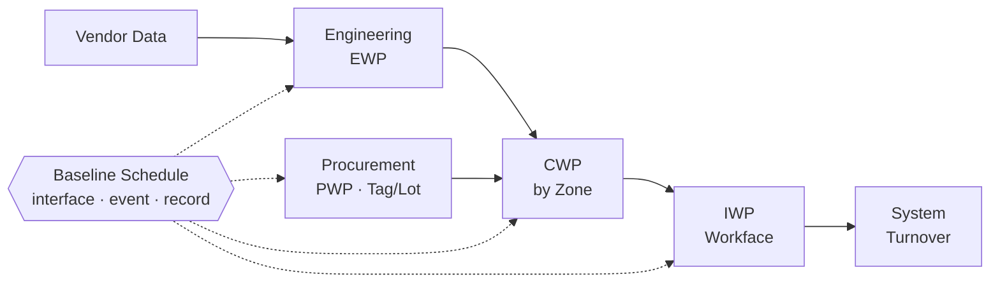
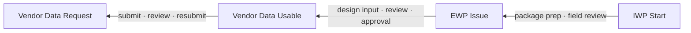
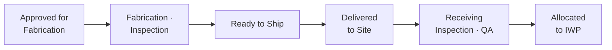
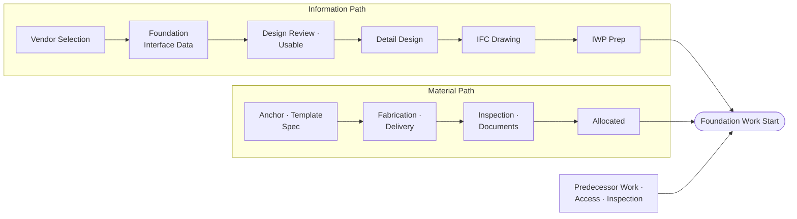

> Zoning과 단위 공간 작업순서를 기준으로, 설계·구매·Vendor Data 등을 Zone별 시공 필요 시점에 연결하여 Site에서의 작업 지연 Risk를 경감. 6개월의 Lead Time과 패키지 수는 임의로 선정한 (제안)값, 실제 계약·공정표·설계 및 구매 Package에 따라 설정 필요. 특정 프로젝트의 내용을 포함하지 않음.

## Key Point

필요한 것은 기존 Zoning 및 시공 Sequence를 새로 만드는 것이 아님, 이미 정교하게 계획한 시공 순서 및 Zoning Plan에 맞추어 설계·구매·Vendor Data interface를 설정하는 것.

현재 상태 가정.

| 구분 | 현재 상태 (가정) |
| --- | --- |
| 시공 | Zone과 Zone별 시공 순서를 정해 간섭을 줄이고 순차 시공을 수행 |
| 설계 | 단위 Level별 도면 발행일을 관리, Zone별 시공 필요와의 연결은 부족 |
| 기기정보 | 설계에 필요한 기기정보에 대한 Interface 없음 (ex. 기기정보 확보 지연으로 구조물 시공 시까지 기기 기초 도면 미발행) |
| 위험 | 구매 지연으로 인한 위험이 시공에 집중 |
| 구매 | 최초·최종 Delivery 일자만 공정표 반영됨, 개별 품목 또는 Bulk Material의 Delivery 지연 impact 계산 어려움 |
| 지연 분석 | 공급사측 지연 Event 발생 시에도 Baseline에 기반한 분석은 어려움 (별도로 영향 분석하더라도 Schedule 기반의 객관성 확보는 곤란) |

현장 시공의 최적화와 함께 이를 가능하게 할 선행 역무와의 Interface를 Baseline schedule 상에서 관리해야 하며, 이를 위해 다음 세 가지를 함께 도입.

| 도입 요소 | 내용 |
| --- | --- |
| **① AWP** | 시공 Activity에 필요한 설계·구매·시공 조건을 연결 |
| **② 통합 interface 일정 관리** | 지연 사건의 후속 작업 및 이로 인한 마일스톤 지연을 공정표 Update에 반영 |
| **③ 지연 사유 및 근거 증빙** | 어떤 interface가 지연되었고, 이로 인한 영향과 당시의 조치 사항 등을 관련 Schedule activity를 기준으로 기록 보관 |

~~**이러한 AWP 도입이 위험을 계약자별로 분배하지는 않음.** 발주자 직접 구매 구조에서는 통합 일정과 인터페이스·계약·증빙관리가 빠지면, 시공사는 더 상세한 패키지를 작성하면서도 종전과 같은 위험을 부담할 수 있다.~~

## 1. 적용 목표와 기본 구조

2025년 한국원자력학회 발표자료에서도 기존 원전 프로젝트의 공종 중심 설계, PO 중심 구매, 시공 중심 일정 사이의 연결 부족을 지적하고, CWA·EWP·PWP·CWP를 연결하는 WBS 보완을 제안.[1] (도입 모델 연구, 공기 단축 실적은 아님)

> [!tip] 원칙
> 설계 조직·구매계약·기존 WBS의 전면 재편은 하지 않음. **기존 체계를 유지하면서 공통 식별자와 연결 관계를 먼저 추가.**

| 관리 대상 | 현재 방식 (가정) | 추가할 연결·완료 기준 |
| --- | --- | --- |
| 시공 | Zone·공종별 순서 | 기존 Activity에 CWA·CWP·IWP와 필요 산출물 연결 |
| 설계 | 단위 Level별 도면 발행 | 각 CWP를 지원하는 승인 산출물 묶음과 필요 시점 관리 |
| 기기정보 | Interface 없음 | Vendor Data 제출·설계 검토·사용 가능 상태 구분 |
| 구매·납품 | 최초·최종 Delivery | Tag·Lot별 현장 사용 가능 시점과 소비 작업 연결 |
| 지연·변경 | 사후 별도 분석 | Event별 영향 경로·일정 버전·당시 증빙 보존 |

| 약어 | 정식 명칭 | 의미 |
| --- | --- | --- |
| CWA | Construction Work Area | 시공의 공간적 구역 |
| CWP | Construction Work Package | 일정한 경계의 시공 범위 |
| EWP | Engineering Work Package | 그 시공 범위를 지원하는 통제된 설계 산출물 묶음 |
| PWP | Procurement Work Package | 구매·제작·납품의 산출물과 시공 사용 단위의 관계 |
| IWP | Installation Work Package | 실제 작업반이 실행할 단위, 작업 준비 조건의 확인 대상 |

> [!note] Zone과 System
> **Zone은 공간적 관리축, System은 기능·시험·인수인계의 관리축.** 두 축을 함께 유지. Zone 공사 완료가 해당 계통의 시운전 가능을 뜻하지는 않음. (System Turnover와 Area Turnover)

## 2. 단계별 도입 계획

| 단계 | 기간 | 핵심 | 완료 산출물 |
| --- | --- | --- | --- |
| 0. 운영 합의 | 1~2주 | 발주자·설계자·시공사 인터페이스 합의 | AWP 실행계획, 역할·책임표, 자료 제공 규칙, 인터페이스 합의서 |
| 1. 패키지 구조 연결 | 3~4주 | 파일럿 선정, Activity–산출물 연결 | 패키지 경계도, Activity–산출물 연결표, 파일럿 시공 경로 |
| 2. 통합 일정 구축 | 2개월 차 | EWP·Vendor Data·납품을 시공 일정에 연결 | 통합 공정표, EWP release plan, Vendor Data 목록, Tag·Lot 납품 계획, 제약 목록 |
| 3. 파일럿 운영 | 3~4개월 차 | 주간 제약 해소, 월간 공식 업데이트 | 제약 해소 기록, Event 영향 보고 |
| 4. 검증·확대 | 5~6개월 차 | 확대 조건 확인 후 인접 구역·공종 확대 | 파일럿 평가 결과 |

### 단계 0. 운영 합의 (1~2주)

첫 단계는 **발주자 참여와 인터페이스 합의**.

| 합의 영역 | 합의 사항 |
| --- | --- |
| 범위·일정 | 파일럿 범위와 공통 공정표, 시공 필요 시점의 작성·검토·확정 방법 |
| 자료 제공 | 구매 조직의 일정·Vendor Data·납품 상태 제공, 설계자의 자료 검토·반영·승인 책임 |
| 운영 규칙 | 일정 업데이트 주기, 변경 승인 절차 |
| 지연 처리 | 지연 통지, 영향 분석, 회복대책 및 비용 처리 절차, 기존 계약상 권리·의무와 기발생 지연의 처리 |

| 역할 | 주요 책임 |
| --- | --- |
| 발주자 책임자 | 설계·구매·시공 간 우선순위와 회복대책 의사결정 |
| 통합 일정 담당 | 선행관계, 업데이트, 영향 분석, 버전관리 |
| 설계 인터페이스 담당 | EWP와 Vendor Data의 적합성·승인 상태 |
| 구매 담당 | 공급업체 약속, 제작·납품·자료 제출 추적 및 독촉 |
| Superintendent·WorkFace Planner | 실제 실행 순서, IWP, 작업 준비 |
| 품질·설계권한 조직 | 원전 품질 확인 및 설계·형상 변경 통제 |

> [!warning] 발주자가 직접 구매하는 경우 (OFCI1)
> 공급업체에 대한 계약상 이행 요구는 발주자 구매 조직의 역무. 시공사는 영향 확인과 실행대안 검토까지, 구매 일정 통제 책임은 넘겨받지 않음. OFCI 구조는 추가 인터페이스를 만들고, 책임 경계와 변경·지연 처리의 불명확성이 분쟁 위험을 높임.[2]

### 단계 1. 패키지 구조 연결 (3~4주)

**파일럿 범위:** 향후 약 6개월 내 실행할 한 구역에서 기기기초 → 기기 설치 → 연결 공사까지.

| 구분 | 제안 규모 |
| --- | --- |
| CWA | 1개 |
| CWP | 3~5개 (기초·기기 설치·연결 배관 등) |
| IWP | 10~20개 (작업반 실행 단위) |

- 앵커볼트 정보, 구매, 설계 반영, 현장 납품이 모두 포함된 범위여야 문제 검증 가능. 완료된 공사의 패키지 재포장은 후순위.

**Activity별 연결 항목**

| 구분 | 연결 항목 |
| --- | --- |
| 패키지·공간 | CWA·CWP·IWP, 건물·층·Zone |
| 계통·기기 | 관련 System·기기 Tag |
| 설계 | 도면·계산서·시방서 및 승인 개정번호, Vendor Data |
| 자재 | 자재·기기·Lot·수량 |
| 실행 조건 | 선행 작업·접근·장비·품질 확인 조건 |

- 기존 Activity의 전면 분해는 불필요. 한 Activity 안에 설계·자재 조건이 달라 착수 시점이 다른 작업이 섞여 있으면 분리.

### 단계 2. 통합 일정 구축 (2개월 차)

3~5절의 방법으로 EWP, Vendor Data, 납품을 시공 일정에 연결. 과거 날짜와 현재 상태를 구분.

| 할 일 | 하지 않을 일 |
| --- | --- |
| 기존 기준공정표·업데이트 이력 보존 | 과거에 없던 선행관계를 당초 합의된 계획처럼 소급 작성 |
| 진행된 설계·구매·입고의 실제 상태 확인 | |
| 현재 시점의 연결된 예측 일정 작성 | |
| 새로 합의하는 기준과 적용 범위 명시 | |

### 단계 3. 파일럿 운영 (3~4개월 차)

| 주기 | 내용 |
| --- | --- |
| 주간 | 다음 작업의 설계·자료·자재·작업 준비 확인 |
| 주간 | 발주자·설계·구매·시공 제약 해소 회의 |
| 월간 (또는 합의한 더 짧은 주기) | 공식 일정 업데이트와 영향 보고 |
| 사건 발생 시 | 별도 Event 등록·통지·영향 분석 |
| IWP 완료 시 | 실제 공수·지연 원인·품질 기록·교훈 회수 |

- 회의의 초점 : 전체 진도율 설명 → **어느 IWP가 무엇 때문에 실행 불가하고, 누가 언제 해소할 것인가**의 결정.

### 단계 4. 검증·확대 (5~6개월 차)

확대 조건 (모두 충족 시 인접 구역·다른 공종으로 확대)

- [ ] 주요 시공 작업의 설계·구매 선행관계 연결
- [ ] 필요한 Vendor Data와 자재 상태의 증빙 확인
- [ ] 실제 변경 사건에 대한 후속 영향 재현
- [ ] 패키지 작성 부담과 현장 효과 평가
- [ ] 미해결 계약·자료 제공 문제 개선

- 첫 파일럿의 성공 기준 : 공기 단축률보다 **연결의 정확성, 조기 경보, 실행 준비, 기록의 신뢰성**.

## 3. 도면 발행 관리 → EWP 관리

EWP = **특정 CWP가 필요로 하는 통제된 설계 산출물의 묶음**. 모든 도면을 Zone별로 다시 그릴 필요 없음.

한 층의 구조도면이 여러 Zone을 포함하는 경우:

| 항목 | 처리 |
| --- | --- |
| 도면 원본·개정 | 하나로 유지 |
| CWP 연결 | 그 도면이 지원하는 CWP들을 모두 연결 |
| CWP별 차이 | 필요한 상세도·Vendor Data·미결사항을 별도 식별 |
| 시공 가능 판단 | 설계권한 조직 |

- 하나의 EWP가 여러 CWP를 지원하는 관계 허용. 숫자 맞추기용 도면 복제 금지.

**EWP 상태 구분**

| # | 상태 |
| --- | --- |
| 1 | 작성 중 |
| 2 | 필요한 입력자료 미확보 |
| 3 | 설계 검토·승인 중 |
| 4 | 해당 범위 시공용 산출물 발행 완료 |
| 5 | 변경으로 해당 범위 사용 재검토 필요 |

> [!tip] 도면 발행 완료 ≠ 현장 사용 가능
> 조건부 발행, 특정 범위 제외, Vendor Data 미반영 등은 상태에 그대로 표시.

**필요 시점 역산**

- 기간은 실제 업무량과 과거 처리 실적 기준. 일률적인 "착수 4주 전" 적용 금지.
- 설계 단계 AWP 연구에서도 설계 공수 투입 시점을 앞당기고 EWP 단위 진도 인정 기준을 조정할 필요성 제시.[3] 전체 도면 진도율과 함께 다음 시공 범위의 설계 준비 여부를 보고.

## 4. 구매 = 납품 + 설계 입력의 두 흐름

### 4-1. Vendor Data를 독립 구매 산출물로 관리

기기 납품보다 훨씬 먼저 필요한 정보 : 앵커볼트 배치·규격·매입, 기기 하중·외형·유지보수 공간, 노즐 위치·연결 조건, 전력·단자·접속, 배관·덕트·관통부 인터페이스.

**PO별 Vendor Data Deliverable Register (최소 필드)**

| 필드 | 내용 |
| --- | --- |
| 식별 | PO·Tag·자료 ID |
| 연결 | 영향받는 EWP·CWP·Activity |
| 일정 | 공급업체 제출 약속일, 설계 필요 시점, 현재 예측일 |
| 상태 | 검토·재제출·사용 가능 |
| 책임 | 책임자, 승인 문서 |

> [!tip] 자료 접수 ≠ 설계 사용 가능
> 최종 제작승인 전이라도 공급업체·설계권한 조직이 인정한 기초 인터페이스는 먼저 활용 가능. 미확정 수치의 현장 임의 사용은 금지.

### 4-2. 최초·최종 Delivery → Tag·Lot별 사용 가능 시점

- 기존 PO의 분할은 필수 아님. 하나의 PO 안에서 현장 사용 단위의 납품 그룹 정의 (ex. A Zone 기기기초용 앵커·템플릿, B Zone 기기 본체·부속품, 특정 배관 IWP의 스풀·밸브·볼트·가스켓 묶음).

| 상황 | 판단 |
| --- | --- |
| 본체 도착, 부속품·품질문서 미비 | 설치 불가 |
| 최종 납품 전, 특정 IWP 필요품 준비 완료 | 그 범위는 실행 가능 |

- 시공 필요 단위는 구매 조직이 공급업체 납품·자료 제공 계획과 연결, 필요 시 계약 변경 또는 별도 합의. 시공 필요 시점 등록만으로 공급업체 계약 의무가 바뀌지는 않음.

## 5. 앵커볼트·Block-out 문제의 공정표 반영

기기 납품과 기초 설계 입력을 별도 선행 경로로 표현.

> [!tip] 핵심
> 일정에 날짜를 적는 것이 아닌 **실제 종속 관계의 입력**. 검토·제작·검사 등 관리 가능한 업무는 숨겨진 Lag 대신 명시적 Activity로 표현. 고정 착수일로 연결 부족을 덮지 않음.

**설명용 예시** (달력일, 기타 조건 동일 가정)

| 구분 | 당초 | Vendor Data 20일 지연 |
| --- | --: | --: |
| Vendor Data 사용 가능 | D40 | D60 |
| 정보 경로 준비 완료 (+55일) | D95 | D115 |
| 기타 선행조건 준비 완료 | D100 | D100 |
| **기초 작업 착수** | **D100** | **D115** |

- 착수 영향 = 20일이 아닌 **15일**. 준공일 영향은 경로 임계성·여유·자원·후속 제약에 따라 별도 판단.

**Block-out을 선택하는 경우** : 일률적 금지가 아닌, 승인된 대체 시공 전략으로 관리.

| 순서 | 내용 |
| --- | --- |
| 1 | 설계·구조·품질 영향 검토 |
| 2 | 당초 일괄 시공과 대체안 비교 |
| 3 | 이후의 앵커 설치·마감·검사·재접근 작업 등록 |
| 4 | 추가 공수·비용·공간 점유와 후속 간섭 확인 |
| 5 | 승인 및 시행 결정 기록 |

- 우선 진행으로 발생한 지연·재작업이 공정표와 비용에서 사라지지 않도록 관리.

## 6. 변경·공급업체 부도 등 Event와 증빙관리

논리 연결만으로 모든 사건의 영향이 자동으로 정확해지지는 않음 (변경 내용·새 처리 기간·영향 범위의 입력과 검토 필요). 다만 매번 연결 관계를 처음부터 찾는 부담은 크게 경감.

| 단계 | 기록·작업 내용 |
| --- | --- |
| **① Event 등록** | 발생·인지·통지 날짜, 사건 내용과 근거 문서, 관련 PO·Tag·도면·자료, 영향 가능 패키지, 대응 책임자, 계약상 책임의 합의 여부 |
| **② 사건 직전 일정 보존** | 당시 업데이트 원본, 기준일·실제 진도·잔여기간·선행관계, 당시 설계·납품 예측과 근거, 합의·미합의·미검증 입력 표시 |
| **③ 필요 작업 추가** | 최종사용자 변경 : 변경 검토·설계 수정·승인·재제작 공급업체 부도 : 기존 제작품·자료 회수 확인, 대체업체 선정·자격·품질 확인, 재발주, 인터페이스 변경·재설계, 제작·시험·운송 (완료된 과거 Activity는 지우지 않고 추가 역무를 별도 식별) |
| **④ 영향·대응안 구분 보고** | 영향받는 CWP·IWP, 착수·완료 및 주요 마일스톤 변화, 여유 소진, 대응 전 영향, 완화대책 후 잔여 영향, 추가 비용·재작업·생산성 손실 가능성 |

- 대체업체 납기 등이 미확정이면 단일 날짜를 확정값처럼 쓰지 않음. 가정별 시나리오와 미확정 상태를 함께 표시.

**Event별 연결 증빙** : 요구·약속·실제 자료 제공 및 납품 시점, 당시 공정표와 변경 사유, 제출·검토·반려 기록, 입고·검사·자재 배정 기록, 일일 작업·인력·장비·대기·재작업 기록, 의사결정·통지·회복지시.

SCL Delay and Disruption Protocol도 발주자 제공 정보·자재 인터페이스의 일정 연결, 당시 기록과 일정 업데이트 보존, 사건 직전 업데이트를 이용한 영향 평가 등을 권고.[4] (실무 지침, 법적 규칙은 아님)

> [!warning] 구분할 것
> - 작업 지연 ≠ 준공 지연
> - 공기연장 ≠ 추가비용 인정
> - 완화대책 시행 ≠ 계약상 권리 포기
> - 구매 문제와 시공사 자체 제약이 동시에 있으면 별도 분석 필요
>
> AWP는 객관성을 높일 기반일 뿐, 청구권이나 책임 배분을 자동 결정하지 않음.

## 7. 원전 특유의 통제와 성과 평가

IAEA SSG-38은 시공에 필요한 통제된 설계·공급업체 정보, 검사·시험, 설계변경·부적합 관리, 추적성 및 인수인계 기록의 중요성을 설명.[5] IAEA의 원전 프로젝트 관리 지침도 AWP와 승인된 설계·자재 정보, 시스템별 인수인계의 연계를 다룸.[6]

**AWP에 통합할 통제**

| 구분 | 내용 |
| --- | --- |
| 승인 | AWP 작업준비 승인과 규제·허가 승인 구분 |
| 검사 | 콘크리트 타설·은폐 작업 전 검사·Hold Point 관리 |
| 기록 | 안전 중요도·품질 요구사항에 따른 기록·추적성 |
| 설계권한 | 대체품·Block-out·시공 변경의 설계권한 검토 |
| 형상 | 개정 도면, NCR 처리, As-built의 패키지 연결 |
| 인수인계 | Zone 완료와 System 인수인계 교차 연결, 자재 입고 이후 보존·관리 책임 |

- 패키지가 Ready여도 미해제된 품질·규제 조건은 건너뛰지 않음. 상세 요건은 해당 국가·허가·프로젝트 품질계획에서 확인 (IAEA 권고 ≠ 국가별 법적 의무).

**파일럿 평가 지표**

| 관점 | 지표 |
| --- | --- |
| 연결 | 주요 시공 Activity의 설계·자료·자재 연결률 |
| 적기 준비 | 필요 시점까지 사용 가능 상태가 된 EWP·Vendor Data·자재 비율 |
| 실행 준비 | 다음 작업의 미해결 제약, 실행 가능한 대체 작업 확보 수준 |
| 손실 | Vendor Data 미확보로 발생한 Block-out·재작업 |
| 대응 속도 | Event 인지 → 최초 영향 분석 소요시간 |
| 기록 | 당시 기록으로 재현 가능한 지연 사건 비율 |
| 효율 | 패키지 준비 추가 공수 대비 현장 대기·재작업 개선 |

- 도면 발행 건수, 전체 입고율, 패키지 작성 건수만으로는 성과를 평가하지 않음.

## 무엇이 개선되고, 무엇은 남는가

| 개선되는 것 | 남는 것 (도입의 전제) |
| --- | --- |
| 설계 지연 시 어느 구역의 어떤 작업이 막히는지 조기 확인 | 공급업체 부도, 사용자 변경, 잘못된 위험 배분 자체는 AWP로 없어지지 않음 |
| 기기 납품 전부터 기초·관통부·배관·전기 설계 입력 지연을 별도 관리 | 발주자의 자료 제공과 구매 이행 관리 |
| 최초·최종 Delivery 사이의 사용 단위별 부족 식별 | 설계권한 조직의 참여 |
| 변경·부도 사건 영향 분석을 위한 연결 관계와 당시 상태 확보 | 계약·인터페이스 합의 |
| Block-out·작업 전환으로 흡수한 손실 가시화 | |
| 구매 약속과 시공 의존관계의 공통 기록 확보 | |

**첫 30일에 확보할 다섯 가지**

1. 파일럿 범위와 기존 시공 경로
2. Activity–도면–Vendor Data–Tag·Lot 연결표
3. 구매 측 자료·납품 약속 및 확인 상태
4. 현재 일정과 원본 이력의 보존·업데이트 규칙
5. 제약·변경·지연 통지와 책임·의사결정 절차

> [!summary] 결론
> 원전 최초 AWP 도입의 출발점은 현장 작업패키지 작성이 아닌 **시공 필요를 기준으로 발주자·설계자·공급업체의 제공 의무와 일정을 연결하는 체계**. 그래야 현장 최적화의 효과가 선행 역무 지연으로 무너지지 않고, 발생한 영향과 비용도 당시에 추적 가능.

> [!note] 주석
> 1. OFCI(Owner-Furnished, Contractor-Installed): 발주자 구매·지급, 시공사 설치 방식

## 참고자료와 확인 범위

1. [한국원자력학회 2025 춘계학술발표 자료: 원전 AWP·WBS 연결 모델](https://www.kns.org/files/pre_paper/53/25S-383-%EC%B6%94%EB%8F%99%EC%9A%B0.pdf). 공개 PDF 확인. 도입 개념 연구 (실제 적용 성과 아님).
2. [NAC, Owner-Furnished / Contractor-Installed (OFCI)](https://www.naocon.org/wp-content/uploads/Owner-Furnished-Contractor-Installed-OFCI.pdf). 공개 PDF 확인. 원전 전용 아닌 프로젝트 인터페이스 참고자료.
3. [Demetracopoulou, Faust & O’Brien, Benefits and Conditions for Successful Implementation of Advanced Work Packaging in Front-End Planning and Design](https://www.researchwithrutgers.org/en/publications/benefits-and-conditions-for-successful-implementation-of-advanced), 2025. [DOI](https://doi.org/10.1061/JLADAH.LADR-1357). 공개 초록 확인, 유료 전체 본문 미확인.
4. [Society of Construction Law, Delay and Disruption Protocol, 2nd Edition](https://www.scl.org.uk/sites/default/files/documents/SCL_Delay_Protocol_2nd_Edition_Final.pdf), 2017. 일정·기록·사건 영향·동시지연·완화 관련 부분 확인.
5. [IAEA, SSG-38: Construction for Nuclear Installations](https://www-pub.iaea.org/MTCD/publications/PDF/Pub1693Web-54107132.pdf), 2015. 설계 인터페이스, 검사·품질, 변경, 기록, 인수인계 관련 절 확인.
6. [IAEA, NG-T-1.6: Management of Nuclear Power Plant Projects](https://www-pub.iaea.org/MTCD/Publications/PDF/PUB1868E_web.pdf), 2020. AWP §4.1.4.5, 품질 §4.5.2, 인수인계 §6.1 등 관련 부분 확인.
7. [CII, Advanced Work Packaging Overview](https://www.construction-institute.org/awp-overview). 패키지 체계 및 경영진·계약·정보 통합·교육의 도입 조건 참고.

## 관련 노트

- [[AWP 적용사례 및 Lessons Learned]]
- [[AWP Advanced Work Packaging|AWP 문헌·사례 읽기 가이드]]
- [[원전 건설 AWP 적용 계획|기존 원전 건설 AWP 적용 계획]]
- [[공정관리계획서의 AWP 반영 항목]] (2.2)
- [[IWP 기반 Lookahead와 제약 관리]] (3.3)
- [[AWP 기반 자재·조달 연계]] (3.4)
