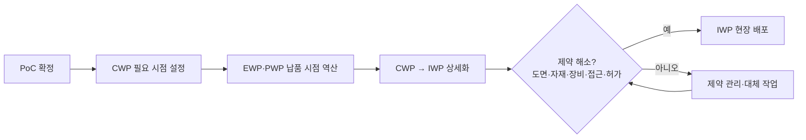

> [!info] 요약
> AWP의 성패는 패키지 수가 아니라, 현장이 필요로 하는 설계·자재·작업 조건이 **해당 패키지의 필요 시점에 실제로 준비됐는지**에 좌우됨. 개괄과 원전 적용은 [[AWP 적용사례 및 Lessons Learned]] 참조.

## 요약
- 현재의 AWP는 Bechtel 고유 방법론이 아닌, CII·COAA가 여러 회사의 work packaging·WFP 경험을 종합한 산업 공통 모델
- 실무 교훈은 실패·개선 사례(Fort McMurray Project B·G)에서 가장 구체적으로 확인됨
- "생산성 25%, 비용 10% 절감"은 보장값이 아님. 직접작업률 개선 근거는 있으나 공기·비용 절감률로 단정 불가

## 1. AWP 구조 이해

CII RT-272가 2009년 연구 착수, 현장 실행 중심의 WFP를 초기 계획·설계 단계까지 연결.

| 구분 | 의미 |
| --- | --- |
| CWA | 어디에서 시공할 것인가 — 공간적 구분 |
| CWP | 해당 구역의 시공 범위와 실행 순서 |
| EWP | CWP 준비·실행에 필요한 설계 산출물 |
| PWP·자재 정보 | 시공 순서를 지원하는 구매·제작·운송·현장 자재 공급 |
| IWP | 작업반에 배포 가능하도록 제약이 제거된 실행 단위 |

**실무 절차.** PoC(Path of Construction) 확정 → CWP 필요 시점에 맞춰 EWP·조달 산출물 납품 시점 결정 → CWP를 IWP로 상세화 → 도면·자재·장비·접근·허가 제약 제거 후 현장 배포.

> [!tip] 실무 포인트 두 가지
> 1. **EWP 발행 완료 ≠ 작업 가능 상태.** 설계가 나와도 자재·비계·선행 작업·접근 공간이 없으면 IWP 실행 불가.
> 2. **EWP:CWP 1:1 고정 불필요.** COAA scalability 자료는 1:1 또는 1:N을 프로젝트별 선택으로 설명(단순화 위해 1:1 권장). 패키지 수 일치보다 지원 관계·경계·필요 시점의 추적 가능성이 중요.

## 2. 우선 읽을 문헌과 사례

| 번호 | 자료 | 성격 | 핵심 가치 |
| --- | --- | --- | --- |
| ① | CII IR319-2 (2015) | 다수 프로젝트 종합 | Lessons Learned 기본 문헌 |
| ② | Fort McMurray Project B·G | 익명 현장 평가 | 가장 실무적인 실패·개선 교훈 |
| ③ | Demetracopoulou 외 (2025) | 학술 연구 | 설계 측 변화 조건 |
| ④ | Qatar NFE LNG (2024) | 업체 게시 사례 | IWP–자재 배정 연결 |
| ⑤ | Shell Quest CCS | 발주자 종료보고서 | WFP 운영·감사 경험 |
| ⑥ | Ponticelli 외 (2015) | 비교 사례 발표 | 실제 비교 성과 수치 |

### ① CII IR319-2 — Lessons Learned 기본 문헌

[Validating Advanced Work Packaging as a Best Practice: A Game Changer (2015)](https://www.construction-institute.org/validating-advanced-work-packaging-as-a-best-practice-a-game-changer). 개별 업체 성공담이 아닌, 여러 산업·규모·성숙도의 적용 경험 종합. RT-272 자료 포함 사례연구 20건, 전문가 인터뷰 25건 분석.

최빈 교훈 5가지:
1. AWP 요구사항을 계약에 포함
2. 주요 참여자 조기 참여
3. 정해진 절차의 실제 준수
4. IT·정보 통합
5. 공종별 IWP 구성

시사점: AWP는 시공팀 단독으로 성립 불가. 설계사·구매팀·제작업체가 무엇을, 어떤 코드·형식으로, 언제 공급할지가 계약·업무절차에 들어가야 함.

함께 볼 자료: [IR272-2](https://www.construction-institute.org/advanced-work-packaging-design-through-workface-execution-version-3-1). Vol. II 계약·역할·통합 절차·평가도구·패키지 템플릿, Vol. III 적용사례·전문가 인터뷰.

> [!note] 확인 범위
> 공식 공개 요약과 핵심 결과까지 확인. 회원용 전체 본문은 미확인.

### ② Fort McMurray Project B·G — 가장 실무적인 실패·개선 교훈

- [Project B: Lessons Learned – Mid Project Review](https://insight-awp.com/case-study-project-b/)
- [Project G: Assessment of WFP Procedures and Recommendations](https://insight-awp.com/case-study-project-g/)

"패키지는 있는데 왜 현장은 계획대로 움직이지 않는가"를 구체적으로 보여주는 자료.

**Project B** (2007~2010, 약 20억 달러, 중간 평가) 기록 문제:
- 시공사 동원 후 시공 경로 변경 → 기존 일정 유효성 붕괴
- EWP·CWP가 현장 FIWP*를 고려하지 않고 구성 → 상세 패키지 개발 곤란
- 제작업체의 전자 데이터 공급 의무 부재 → 수작업으로 뒤늦게 추출
- 일정·단가 기준 불일치 → FIWP의 Planned Value 산정 불가
- 자재 확보·장비 배정이 배포 제약 조건으로 관리되지 않음
- 현장 감독자가 패키지를 임의 분해해 필요한 작업만 선택, 피드백·회수 절차 부족

긍정적 결과: 전체 RFI 약 4,000건 중 45%를 WorkFace Planner가 실행 전 제출. 패키징의 가치는 문제 제거뿐 아니라 **착수 전 문제 발견**에도 있음.

**Project G** (약 18억 달러, 2013년 7일간 인터뷰 54회): 일정에 CWP·FIWP가 있어도 공식 제약 관리와 실행 가능 작업 backlog 부족. 모듈이 시공 순서와 다르게 공급되는 문제 기록.

바로 적용할 개선 권고:
- IWP에 Planned Value 부여, 일정·진도와 연결
- 비계·임시전력 등 간접 작업도 통합 일정에 반영
- 자재·장비·비계 준비 여부를 배포 조건으로 관리
- 실행 가능한 대체 작업 확보
- WorkFace Planner가 Superintendent의 실행 전략을 지원하는 조직 구성

> [!warning] 주의
> 익명 프로젝트, 컨설팅사 공개 초기 WFP 평가자료. AWP 전체 효과 입증 연구가 아닌 현장 실행 단계의 Lessons Learned로 보는 것이 적절.

* FIWP(Field Installation Work Package): IWP의 COAA 초기 명칭.

### ③ Demetracopoulou·Faust·O'Brien (2025) — 설계 측 변화 조건

*Benefits and Conditions for Successful Implementation of Advanced Work Packaging in Front-End Planning and Design* — [초록](https://www.researchwithrutgers.org/en/publications/benefits-and-conditions-for-successful-implementation-of-advanced) · [DOI](https://doi.org/10.1061/JLADAH.LADR-1357)

"EWP를 CWP 필요에 맞춰 공급하려면 설계 업무가 어떻게 바뀌어야 하는가"에 가장 직접 연결되는 연구. 전문가 14명 + 업계 전문가 101명 설문.

주요 내용: 시공 경로 계획 중 제약 가시성 개선, 데이터 무결성 확보, 설계 공수 투입 시점 전진, EWP 단위 진도 인정 기준 변경.

실무적 의미: 기존 설계 관리는 공종별 전체 도면 진도율로 판단. AWP에서는 **다음 CWP가 필요로 하는 설계 묶음의 완성 여부**가 기준. EWP 납품일 신설만으로 부족하며, 설계 인력 투입 계획·진도 인정 기준·보고·지급 조건까지 함께 조정 필요.

> [!note] 확인 범위
> 공개 초록까지 확인. 8개 권고의 상세 본문은 미확인.

### ④ Qatar North Field East LNG (2024) — IWP와 자재 배정 연결

[CCC / WorkPacks, Beyond Conventional AWP: NFE Case Study (PDF)](https://workpacks.com/wp-content/uploads/2024/02/CCC-AWP-Case-Study1.pdf) — 특히 11~20쪽.

Chiyoda-Technip JV의 설계·조달과 CCC의 시공이 연결되는 대형 LNG 현장 적용 내용:
- MTO 중심 자재 배정 → IWP 중심 자재 배정으로 전환
- CWP별 constructability 검토
- 현장 조건에 대응하는 동적 IWP release plan
- 6개월 전망, 90일 제약·자원 가시성
- CWP release notice와 일정 비교
- 문서관리 시스템 연계, 변경 도면 즉시 배포

핵심 교훈: "필요 자재 구매 완료"와 "이번 IWP에 쓸 자재 배정 완료"는 다른 상태. IWP별 자재 준비·배정 상태까지 내려가는 것이 핵심.

> [!warning] 주의
> 진행 중 프로젝트의 적용 기록. 검증된 생산성·공기·비용 수치 없음. 솔루션 업체 게시 자료로 운영 방식 참고용이며 독립적 성과 검증으로는 한계.

### ⑤ Shell Quest CCS — 완료 프로젝트의 WFP 운영·감사 경험

- [Shell Quest Project Close-Out and Lessons Learned Report](https://open.alberta.ca/dataset/67f52cd3-8dce-4f56-ad62-a00ff7948fd0/resource/729b0c09-8b46-4465-ba69-05c34453c432/download/closeoutreport.pdf)
- [Fluor 프로젝트 소개](https://www.fluor.com/projects/shell-quest-carbon-capture-epc)

발주자 종료보고서라는 점에서 솔루션 홍보자료보다 가치 높음. 종료보고서 §18.6.6과 프로젝트 리뷰에 초기 단계 WFP 도입, 실행 중 감사·지속 개선, 약 80개 WFP 교훈 축적 기록. 고품질 FIWP와 지연 원인 추적 도구가 긍정적 경험으로 제시됨.

핵심 교훈:
- WFP를 현장 동원 후가 아닌 초기 단계부터 준비
- 패키지 품질을 현장 사용자 관점에서 평가
- 배포 후 실제 지연과 사용 경험 추적
- 감사로 절차와 실제 운영 간 차이 수정

> [!warning] 주의
> 공개 자료로 확인되는 것은 WFP·FIWP 적용까지. EWP→CWP→IWP 전체 연계 입증은 아님 → "완료된 WFP 적용 사례"로 분류가 정확. 해당 절·부록 색인 내용까지 확인, 전체 PDF 본문은 미확보.

### ⑥ Ponticelli·O'Brien·Leite (2015) — 실제 비교 성과

*Advanced Work Packaging as Emerging Planning Approach to Improve Project Performance* — [공개 발표 PDF](https://pdfs.semanticscholar.org/8346/9ea8bb472071a727771718fe0d1fa104ff77.pdf), 10~15쪽에 비교 조건과 결과.

동일 범위·동일 회사·인접 현장·병행 수행 조건의 사례 비교:

| 사례 | 규모 | AWP 적용 측 결과 |
| --- | --- | --- |
| 유정 확장 | 800만 USD | 예산 대비 75만 달러 절감, 5일 조기 완료 |
| 제방·처분장 | 4억 CAD | TIC 10% 절감, 일정 준수 |

운영 측면: IWP 진도 기준 주간회의, IWP 완료 후 교훈 반영, 일일 계획 갱신, AWP 산출물과 지급 구조 정렬. 가치는 숫자보다 **패키지 진도와 회의·지급·피드백의 연결**.

> [!warning] 주의
> 익명 사례·발표자료이며 CII 연구 계열과 중복. CII 자료와 별개 독립 표본으로 중복 계산하거나, 보고 수치를 전체 평균 효과로 사용 금지.

## 3. "생산성 25%, 비용 10% 절감"의 해석

자주 인용되나 모든 프로젝트의 보장값 아님. 가장 유용한 보완 근거:

[Porwal·O'Brien·Borcherding (2025), Examining the Impact of AWP and WFP on Direct Work Rates](https://www.frontiersin.org/journals/built-environment/articles/10.3389/fbuil.2025.1621337/full) — 84개 프로젝트, 두 데이터셋.

| 구분 (Dataset-I, 61개) | 평균 직접작업률 (%) |
| --- | --- |
| 전통방식 | 35.00 |
| WFP | 40.18 |
| AWP + WFP | 42.75 |

해석 시 구분:
- AWP군 vs 전통방식: 7.75%p 차이, 상대 차이 약 22.14%
- AWP군 vs WFP군: 통계적으로 유의한 차이 없음
- 관찰 비교연구로 프로젝트 조건 차이 완전 제거 불가. 지표는 산출량/노무시간이 아닌 직접작업 시간 비율

결론: AWP가 현장의 비생산적 시간 감소에 도움이 된다는 근거는 있음. 공기·비용을 일정 비율 줄인다고 단정 불가.

**실명 사례의 주의점 — Golden Pass LNG.** 초기 AWP 사례에서 일정 작성 29,050시간, 패키지 개발 120,000시간의 업무 절감 보고. 단, 이는 계획 업무 공수. 이후 주 시공사 Zachry가 2024년 프로젝트에서 이탈, Train 1 첫 LNG 생산은 2026년 3월 30일 발표(원문 기재). 초기 도구 활용 성과를 프로젝트 전체 일정 성공으로 해석하면 안 되는 사례.

## 4. EPC 적용을 위한 종합 교훈

특정 문헌의 규칙이 아닌, 사례 종합에 따른 실무 판단.

1. **CWA·CWP 경계와 시공 경로는 설계 상세화 전에 합의.** 설계팀이 먼저 나누고 현장이 나중에 맞추는 방식은 재패키징과 일정 재작업 유발.
2. **EWP 일정은 도면 발행일 하나로 끝내지 않음.** Vendor data, IFC 도면, MTO, 모델 정보의 필요 시점과 CWP·IWP 준비 시간을 함께 연결.
3. **"패키지 작성 완료"와 "실행 가능" 상태 분리.** IWP 배포 전 최신 도면, 자재 배정, 선행 작업, 장비, 비계, 접근, 안전·품질 조건 확인.
4. **일정·진도·공수 기준을 패키지 수준에서 일치.** 패키지 번호만 일정에 넣고 진도·비용을 다른 기준으로 관리하면 편차 원인 추적 곤란.
5. **WorkFace Planner는 현장 실행 전략 지원 역할.** Project Controls의 상세계획을 일방 전달하는 구조보다 Superintendent와 함께 실행계획을 만드는 구조가 중요.
6. **Lessons Learned는 다음 패키지와 절차를 바꿔야 함.** 지연 원인을 기록만 하지 말고 다음 IWP의 크기·순서·제약 확인·설계 납품 요구사항에 반영.

**국내 적용 환경.** [Comparative Analysis of AWP Implementation by Construction Companies in South Korea (2025)](https://doi.org/10.6106/KJCEM.2025.26.1.083) — 국내 주요 건설사 6개사 인터뷰·설문. 경험·조직·업무 프로세스·정보 통합·성숙도 차이 조사, 5개 이상 프로젝트 경험사부터 경험 없는 회사까지 큰 격차 확인. 개별 프로젝트 성과검증보다 자사 도입 준비 수준 점검용 자료에 가까움.

> [!tip] 추천 읽기 순서
> Project B·G 실패 교훈 → 2025년 설계 연구 → NFE 운영 사례 → CII IR319-2·IR272-2

## 참고
- [CII – Validating AWP as a Best Practice (IR319-2)](https://www.construction-institute.org/validating-advanced-work-packaging-as-a-best-practice-a-game-changer)
- [CII – AWP Design through Workface Execution v3.1 (IR272-2)](https://www.construction-institute.org/advanced-work-packaging-design-through-workface-execution-version-3-1)
- [Insight AWP – Project B Case Study](https://insight-awp.com/case-study-project-b/)
- [Insight AWP – Project G Case Study](https://insight-awp.com/case-study-project-g/)
- [Demetracopoulou, Faust & O'Brien (2025)](https://doi.org/10.1061/JLADAH.LADR-1357)
- [CCC / WorkPacks – NFE Case Study (2024)](https://workpacks.com/wp-content/uploads/2024/02/CCC-AWP-Case-Study1.pdf)
- [Shell Quest Close-Out and Lessons Learned Report](https://open.alberta.ca/dataset/67f52cd3-8dce-4f56-ad62-a00ff7948fd0/resource/729b0c09-8b46-4465-ba69-05c34453c432/download/closeoutreport.pdf)
- [Ponticelli, O'Brien & Leite (2015)](https://pdfs.semanticscholar.org/8346/9ea8bb472071a727771718fe0d1fa104ff77.pdf)
- [Porwal, O'Brien & Borcherding (2025)](https://www.frontiersin.org/journals/built-environment/articles/10.3389/fbuil.2025.1621337/full)
- [Comparative Analysis of AWP Implementation in South Korea (2025)](https://doi.org/10.6106/KJCEM.2025.26.1.083)
- 관련 노트: [[AWP 적용사례 및 Lessons Learned]]
- 본 사이트: [conpal.kr](https://conpal.kr)
