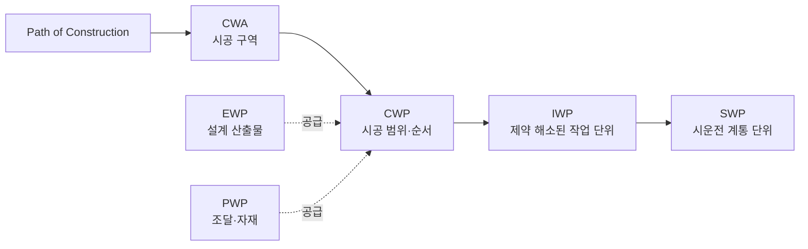

> [!info] 요약
> AWP의 본질적 효과는 생산성 평균 상승보다 **분산 축소(예측가능성)**. 원전 full-scale 적용 공개 사례는 아직 없음.

## 요약
- AWP = 시공 순서(PoC)를 척추로, CWA → CWP → IWP 중심에 EWP·PWP를 맞춰 공급하는 체계
- CII 대표 수치(생산성 최대 25%↑, TIC 최대 10%↓)는 "최대치"이며 증거의 질에 한계 존재
- 최신 84개 프로젝트 실증: AWP의 진짜 차이는 평균이 아닌 **편차**
- 원전(KINGS 2025 연구): 원자로건물 같은 단일 critical 구역은 재배열 여유 거의 없음

## 1. 큰 그림: AWP 구조와 기원

**구조.** CWA → CWP → IWP 중심, EWP·PWP를 CWP 순서에 맞춰 공급하는 구조. 척추는 PoC(Path of Construction, 시공 순서 로드맵).

- CWA와 CWP는 1:N 관계
- CWP를 PoC 순서로 배열한 것이 Level 3 공정표
- EWP는 시공이 필요로 하는 순서대로 설계정보가 나오도록 PoC에 맞춰 배열

**기원.** Bechtel 단독 개발이 아닌, 실무자 개발 → CII·COAA(앨버타 발주자협회) 체계화. 2015년 CII가 RT-319 검증 근거로 Best Practice 지정. WFP(WorkFace Planning)는 2000년대 초 COAA 회원사 개발 단기 공정계획 기법. 캐나다 오일샌드 프로젝트가 출발점.

**공정표 레벨 정의 (CII 용어집).**

| 레벨 | 내용 |
| --- | --- |
| Level 3 (Integrated Project Schedule) | EWP·PWP·CWP를 FS 관계 activity로 표현 |
| Level 4 | IWP 1개 = activity 1개 |

## 2. 핵심 문헌 (읽는 순서)

| 순서 | 문헌 | 성격 |
| --- | --- | --- |
| 1 | [CII IR 272-2 Vol. I~III (2013)](https://www.construction-institute.org/advanced-work-packaging-design-through-workface-execution-version-3-1) | AWP 원전(原典). Vol. II 계약·직무·성숙도 모델·공종별 IWP 체크리스트, Vol. III 사례·전문가 인터뷰 |
| 2 | [CII IR 319-2 (2015)](https://www.construction-institute.org/validating-advanced-work-packaging-as-a-best-practice-a-game-changer) | 성과 검증, Lessons Learned 목록 |
| 3 | [CII RT-DCC-04 (2020)](https://www.construction-institute.org/promoting-the-use-of-advanced-work-packaging-phase-1) | 도입 장애요인 분석 |
| 4 | [CII RT-390 AWP Execution Planning Guide (2023)](https://fliphtml5.com/eozvi/lbat/CII_AWP_Execution_Planning_Guide/118) | 최신 실행 가이드 |
| 5 | [KINGS 원전 AWP 논문 2편 (2025)](https://www.mdpi.com/2076-3417/15/20/11113) | 한국 원전 적용 연구 (가장 관련 깊음) |

## 3. 정량 성과와 증거의 질

**대표 수치 (CII).** 현장 생산성 최대 25% 향상, TIC(총설치비) 최대 10% 절감. 근거는 RT-319의 사례연구 20건, 전문가 인터뷰 25건. "최대치"이며 성숙도 Level 3(전사적 업무 전환) 조직 기준.

**증거의 한계.**
- CII 수치는 프로젝트 자체 baseline 대비 비교, 절대 생산성 측정 아님
- 북미 프로젝트 중심, 2015년 이전 work sampling 자료는 COAA 단일 프로젝트 수준
- 앨버타대 연구: 비용·편익 평가 방법 부재로 정량 증거 부족이 도입 걸림돌

**최신 대규모 실증 ([Porwal·O'Brien, 2025](https://www.frontiersin.org/journals/built-environment/articles/10.3389/fbuil.2025.1621337/full)).** 2015~2023년 84개 프로젝트 work sampling 분석.

| 구분 (Dataset-I, 61개) | 직접작업률 평균 (%) | 표준편차 | 변동계수(CV) |
| --- | --- | --- | --- |
| AWP (WFP 포함) | 42.75 | 2.88 | 0.07 |
| WFP만 적용 | 40.18 | 6.57 | 0.17 |
| 전통방식 | 35.00 | 5.48 | — |

- AWP·WFP 모두 전통방식 대비 통계적으로 유의하게 높음
- AWP와 WFP 간 평균 차이는 통계적으로 유의하지 않음 → 진짜 차이는 편차
- WFP만 적용 시 평균은 상승하나 하위 꼬리는 전통방식과 유사. 늦은 설계·조달의 결과는 현장에서 바로잡기 어렵다는 의미
- 참고: 1986년 미국 연구의 직접작업률은 화력 37.7%, 원자력 32.3%로 원전이 낮은 축

> [!tip] 해석
> AWP = 현장 생산성 분포의 꼬리를 자르는 장치.

> [!note] 주석
> 직접작업률(direct-work rate): 작업자가 실제 설치 작업에 쓴 시간 비율. 이동·대기·자재 찾기 제외.

## 4. Lessons Learned

### (1) CII RT-319 최빈 교훈 Top 5
1. AWP를 계약에 포함
2. 핵심 참여자 조기 참여
3. 정해진 지침·절차에 대한 완전한 준수와 몰입
4. IT 통합
5. 공종별 IWP 구성

성공 전제조건 3가지: AWP 절차 준수, 조직 내·조직 간 프로세스 정렬, AWP 역할·책임의 계약 통합.

### (2) 성숙도별 장애요인 (RT-DCC-04, 36개사 68명 설문)

| 성숙도 | 주요 장애요인 |
| --- | --- |
| 고성숙 | 설계(Engineering)와의 통합 |
| 중간 | 인식 부족 + 설계 통합 문제 혼재 |
| 저성숙 | 효과 불신, 무관심 |

78개 장애요인, 500개 이상 해결책 정리. 요점: 오래 할수록 남는 숙제는 설계 조직을 시공 순서에 맞추는 일.

### (3) 실패 사례: 미국 걸프만 25억 달러 메가프로젝트 ([Glen Staggs](https://tconglobal.com/lessons-learned-implementing-awp-megaproject/))

2014년 FEL-2 단계부터 AWP 도입, FEED 수개월 단축 시도. 정체 발생 후 근본원인 파악이 어려워지며 AWP 이행 무력화.

- 경영진 교육: 승인만으로 부족, 조직 전체 영향과 필요 투자 이해 필요
- 조직 정렬: 일부 부서의 사일로 방식 고수 시 문제 발생
- 더 일찍 시작

> [!warning] 핵심 각주
> FEED 단계 PoC 적용 시 공격적이던 공정·견적이 더 정확해짐 → 공기가 처음엔 **늘어 보일 수 있으므로** 경영진에 사전 설명 필요.

### (4) 병목 이동 현상 ([실제 적용 발표자료](https://www.slideshare.net/slideshow/advanced-work-packaging-real-life-implementation/40114665))

도면·자재 가용성에만 집중 → 병목이 시험·시운전으로 이동하는 "90% 증후군" 발생. 그 밖에 작업 우선순위, 자원 간 작업량 불균형, 후속 공정 병목, 부분 최적화 문제. CII 시운전 통합 연구(RT-364, SWP: System Work Package)의 배경.

### (5) 첫 파일럿 교훈 ([Concord](https://tconglobal.com/piloting-advanced-work-packaging-lessons-learned/))
- WBS: 기존 도면·산출물·공정표 번호체계는 PoC와 불일치하는 경우 많음. 단, 가장 해결 쉬운 문제
- 조달: 조달이 PoC 속도를 못 따라가는 것이 현장 진척을 가장 크게 저해

※ Concord 제시 사례 수치(인건비 180만 달러 절감 등)는 AWP 컨설팅 판매사 자료이므로 할인해서 읽을 것.

## 5. 원전 적용: KINGS 2025 연구

KEPCO 국제원자력대학원대학교(KINGS) 정우용 교수팀 연구. 신고리 3·4호기 FSAR 기반 Nuclear Island 축소 모델을 P6로 구현.

**현황.** AWP의 원전 건설 적용 사례 없음. 일부 원전 발주처가 입찰자에게 AWP 적용 검토 요구 시작. 저자들도 원전 full-scale 적용 공개 사례 없음을 명시.

**WBS 재구성.** Project → CWA → Phase(E/P/C) → Discipline(OBS) → WP. CWA를 Level 2에 둔 것이 핵심.

**공정표 규모 변화.**

| 항목 | 전통방식 | AWP-M1 | AWP-M2 |
| --- | --- | --- | --- |
| 전체 activity | 517 | 686 | 647 |
| 설계 산출물 | 269 | 940 | 940 |
| Work package | 48 | 202 | 163 |

설계 activity 6.6배 증가, 시공 activity는 기존에도 구역별 계획이라 소폭 증가.

**P6 실무 기법.**
- ENG-IF: 같은 도면을 여러 CWP가 공유할 때의 로직 문제를 SI(최조 시작)/FI(최종 완료) 인터페이스 activity로 해결
- IEWP: 설계-시공 간 기존 interface activity를 EWP 발행 activity로 대체

**공기 효과.** 생산성 25% 향상으로 120일 단축, 90일 EWP 선행 lag로 일부 상쇄 → 순 60일 단축.

**지연 복구 결과.**
- 보조건물(AB): 인접 CWA에 같은 공종 존재 → 재배열로 23~74일 회복
- 원자로건물(RCB): 연속된 critical 구조 범위로 대체 작업 없음 → 회복 불가

**저자 명시 한계.** 25%는 문헌 기반 가정값, 결정론적 분석으로 신뢰구간 없음, 전통방식에서도 실제로는 재배열이 이루어지므로 AWP 효과 과대평가 가능성.

## 6. 공정관리 관점의 시사점

- **AWP의 공정상 본질**: CPM 로직 자체보다 착수 조건(constraint)의 사전 확보 체계. Level 3(CWP/EWP/PWP) 통합 + Level 4 IWP 단위 constraint 관리의 이원 구조. 제약 해소된 IWP만 현장 발행.
- **원전 적용의 핵심 난제**: RCB 같은 단일 critical 구역은 재배열 여유 거의 없음. 원전에서의 가치는 공기 단축보다 설계·조달 준비도 가시화와 계통 단위 시운전 인터페이스 관리.
- **지연분석과의 연결**: IWP 발행 이력과 constraint log = "언제 무엇이 준비되지 않아 착수하지 못했는가"의 동시대 기록(contemporaneous record). 클레임·포렌식 관점에서 AWP는 증거 생성 체계이기도 함. 문헌에서 거의 다뤄지지 않은 영역.
- **국내 자료 공백**: 한국어 AWP 실무 자료 거의 없음, 원전 분야는 2025년 KINGS 논문이 사실상 첫 시도.

## 참고
- [CII – Validating AWP as a Best Practice (IR319-2)](https://www.construction-institute.org/validating-advanced-work-packaging-as-a-best-practice-a-game-changer)
- [CII – Transforming the Industry: AWP as a Standard (Best) Practice](https://www.construction-institute.org/transforming-the-industry-advanced-work-packaging-as-a-standard-best-practice)
- [CII – AWP Design through Workface Execution v3.1 (RT-272)](https://www.construction-institute.org/advanced-work-packaging-design-through-workface-execution-version-3-1)
- [CII – Validating AWP RT-319 Plenary](https://www.construction-institute.org/validating-awp-319-plenary)
- [CII – Promoting the Use of AWP Phase 1 (RT-DCC-04)](https://www.construction-institute.org/promoting-the-use-of-advanced-work-packaging-phase-1)
- [CII – Promoting the Use of AWP Phase 2](https://www.construction-institute.org/promoting-the-use-of-advanced-work-packaging-phase-2)
- [CII – AWP Acronyms & Definitions](https://www.construction-institute.org/CII/media/Documents/AWP-Acronyms-Definitions.pdf)
- [CII – AWP vs Lean Construction Comparison](https://construction-institute.org/api/resource/download/7430)
- [CII AWP Execution Planning Guide (RT-390)](https://fliphtml5.com/eozvi/lbat/CII_AWP_Execution_Planning_Guide/118)
- [Porwal, O'Brien, Borcherding (2025), Frontiers in Built Environment](https://www.frontiersin.org/journals/built-environment/articles/10.3389/fbuil.2025.1621337/full)
- [Choo & Jung (2025), AWP Schedule Analysis for NPP, Applied Sciences](https://www.mdpi.com/2076-3417/15/20/11113)
- [Choo & Jung (2025), AWP for Nuclear Construction: WBS Review, KNS](https://www.kns.org/files/pre_paper/53/25S-383-추동우.pdf)
- [Halala, Framework to Assess Costs and Benefits of AWP (U. Alberta)](https://era.library.ualberta.ca/items/7d63c96b-5a56-47cd-803f-d9a88cc3a678)
- [AWP Real Life Implementation (SlideShare)](https://www.slideshare.net/slideshow/advanced-work-packaging-real-life-implementation/40114665)
- [Concord – Lessons Learned: Implementing AWP on a Megaproject](https://tconglobal.com/lessons-learned-implementing-awp-megaproject/)
- [Concord – Piloting AWP: 7 Lessons Learned](https://tconglobal.com/piloting-advanced-work-packaging-lessons-learned/)
- 본 사이트: [conpal.kr](https://conpal.kr)
