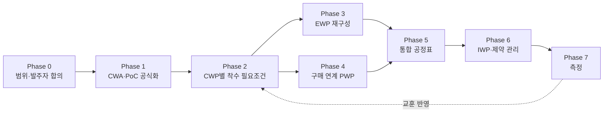

> [!info] 요약
> 기존 Zoning·공종 순서 기반 구역 순차 시공은 이미 AWP의 CWA·PoC에 해당. 새로 필요한 것은 시공이 아닌 **설계·구매를 구역 순서에 역산해 공정표 로직으로 연결하는 일**. 발주자 직접 구매 구조에서 AWP의 진짜 가치는 생산성보다 **책임 경계의 가시화**.

> [!note] 전제 조건
> AWP 미적용 경험 조직. 시공은 구역 분할·공종 순서로 중복 없이 순차 진행해 옴. 설계는 단위 Level별 도면 발행일정만 관리, 기자재 구매는 발주자 직접 관리.

## 1. 현재 상태 진단

| 구분 | 현재 | AWP 기준 | 차이 |
| --- | --- | --- | --- |
| 시공 | 구역 분할 + 공종 순서 | CWA + PoC | 거의 충족, 공식화·코드화만 필요 |
| 설계 | 단위 Level별 도면 발행일 | CWP가 필요로 하는 설계 묶음(EWP) | 구역 단위 관리 없음 |
| 기기정보 의존 설계 | 관리 포인트 없음 | Vendor data 확정 → 설계 확정 선행조건 | 구조적 공백 |
| 구매 (발주자 직접) | 최초·최종 입고일만 반영 | Tag 단위 CWP 연결 | 개별 기기–작업 연결 없음 |
| 이벤트 영향 | 별도 상세분석 필요 | 공정표가 자동 계산 | 로직 부재 |

핵심 원인: **"이 구역을 착수하려면 무엇이 필요한가"가 공정표 로직으로 연결되어 있지 않음.** 그 결과 설계·구매 단계의 사건에 공정표가 반응하지 않음.

## 2. 적용 절차



### Phase 0. 범위·합의

- **발주자 합의 필수.** 구매 주체가 발주자이므로 시공사 단독으로는 AWP 불성립. 계약 또는 절차서에 다음 반영:
    - Vendor data 공급 의무와 시점
    - 입고 예상일 갱신 주기
    - ROS<sup>1</sup> 통보에 대한 회신 절차
- **파일럿 범위.** 전 구역 일괄 적용 지양. 보조건물(AB) 1개 구역 수준에서 시작.
    - KINGS 연구에서도 AB는 인접 구역의 동일 공종으로 재배열 여유 존재
    - RCB는 공기 단축보다 제약 가시화 목적으로 적용

### Phase 1. CWA·PoC 공식화

- 기존 Zoning → CWA 코드화, 공종 순서 → PoC 문서 확정
- CWP 정의 단위: CWA × 공종 × 레벨 구간 (예: AB-Z3 EL.100~120 구조체)
- CWA–CWP–IWP를 P6 Activity Code·UDF<sup>2</sup>로 부여. 이후 모든 연결의 기준 키

### Phase 2. CWP별 착수 필요조건 목록 (역산)

AWP 전환의 실질적 첫 산출물. 각 CWP마다 아래 항목 나열.

| 항목 | 예시 (구조체 CWP) |
| --- | --- |
| 설계 | IFC 도면 번호 목록 |
| Vendor data | 기기기초 앵커볼트 위치·규격, 매립물, 개구부 |
| 자재·기기 | 매립철물, 발주자 공급 기기 (Tag No.) |
| 선행 작업 | 선행 CWP |
| QA·인허가 | ITP hold point, 규제기관 검사 |

산출물: **CWP ↔ 도면번호 ↔ Tag No. ↔ PO 연결표.** 흩어진 정보를 구역 기준으로 통합하는 작업.

### Phase 3. EWP 재구성 (설계)

- 기존 Level별 도면 리스트는 유지, 각 도면을 CWP에 매핑해 EWP로 묶음. 설계사 관리 체계 변경이 아닌, 그 위에 한 겹을 얹는 방식
- **EWP 필요일 = CWP 착수일 − IWP 준비기간** (예: 60~90일)
- **Vendor data 의존 도면 별도 표시.** 예: 기기기초 도면 Final Issue의 선행조건 = 해당 기기 Certified vendor drawing<sup>3</sup> 승인
    - 반복되는 block-out의 근본 원인이 이 연결의 부재
- 설계 진도: 기존 도면 진도율에 "EWP 완료율" 추가 관리

### Phase 4. 구매 연계 (발주자 구매 품목)

- 발주자 구매 품목을 Tag 또는 Tag 그룹 단위로 CWP에 연결
- 공정표 마일스톤 체인 (굵은 노드는 최소 필수):

```
PO → Vendor drawing 1차 제출 → [Certified vendor data] → 제작 → FAT → 선적 → [현장 입고(ROS)] → 설치 가능
```

- **ROS를 공정표에서 역산해 발주자에게 공식 문서로 통보.** 통보 이력 자체가 증빙
- 전 품목 대상 지양. 주공정 품목과 vendor data 의존 품목부터 적용 (파레토 원칙)

### Phase 5. 통합 공정표 구조

- Level 3: EWP·PWP·CWP를 FS 관계로 연결
- Level 4: IWP 단위 관리
- **모든 인터페이스 노드에 책임 주체 코드 (Owner / Contractor / Vendor / Designer) 부여.** 분쟁 대응의 핵심 장치
- KINGS 연구 기법 활용: IEWP (EWP 발행 activity), ENG-IF (복수 CWP 공유 도면의 인터페이스 노드)

### Phase 6. IWP·제약 관리 (현장)

- 주간 제약 회의, 제약 해소된 IWP만 현장 배포
- **Block-out 등 우회 작업은 "임시 조치 IWP"로 별도 기록.** 추가 작업·재작업 공수·지연의 원인 책임이 공정표에 잔존

### Phase 7. 측정

- EWP 적기 발행률
- Certified vendor data 적기 확보율
- 제약 해소 IWP backlog (2~4주분)
- Block-out 발생 건수

## 3. 현재 문제별 개선 효과

| 현재 문제 | AWP 적용 후 |
| --- | --- |
| Level별 도면만 관리 → 구역 착수 가능 여부 판단 불가 | "Z3 착수 필요 도면 중 미완 3건, 그중 2건 vendor data 대기" 식으로 착수 가능성 수치화 |
| 앵커볼트 정보 부재 → block-out 상시 발생 | 3~6개월 전 제약으로 식별, 필요일 발주자 공식 통보. 미확보 시 block-out을 계획된 대안으로 결정·기록 → 추가비용 청구 근거 |
| 발주자 구매 지연 → 입고 마일스톤만 존재 | 기기 1건 지연이 어느 CWP·IWP를 얼마나 미는지 공정표가 즉시 계산 |
| 최종사용자 변경·공급사 부도 → 영향 미확인 | 해당 노드에 fragnet<sup>4</sup> 삽입 시 후속 작업 착수 가능일 즉시 산출. TIA 상시 가능 구조 |
| 증빙 신뢰성·객관성 모호 → 리스크 편중 | 사건 시점 공정표 자체가 동시대 기록. SCL Protocol 관점 증거력 향상, 책임 코드로 리스크 배분 근거 명확 |

## 4. 시사점

**① 책임 경계의 가시화.** 발주자 구매 구조에서 공정표의 인터페이스 노드 = 계약상 책임 경계. 현재는 경계가 공정표에 없어 사건마다 사후 재구성이 필요하고, 재구성하는 쪽이 입증책임을 부담. 시공사가 리스크를 떠안아 온 구조적 원인. AWP는 이 경계를 사전에 로직으로 고정하는 장치.

**② 발주자 반대 가능성.** 발주자 측 지연이 투명해지기 때문. 설득 논리는 발주자 이익 중심:
- 예측가능성 향상
- 클레임 감소: 사후 재구성 다툼 → 사실관계 확인으로 전환
- Turnover·시운전 준비도 가시화

"시공사 클레임 도구"로 인식되면 실패.

**③ 관리 부담.** KINGS 모델에서 activity 517 → 686개, 설계 activity 6.6배 증가. 대응 원칙:
- 주공정·vendor data 의존 품목부터 단계 적용
- 연결표(Phase 2)는 엑셀·DB로 관리, 공정표에는 핵심 노드만 반영

**④ 초기 공기 증가 착시.** ROS 역산과 IWP 준비기간 반영 시 숨어 있던 리스크가 드러나 공기가 늘어 보일 수 있음. 경영진·발주자 사전 설명 필요.

> [!note] 주석
> 1. ROS(Required On Site): 시공에 필요한 현장 입고 요구일. 공정표에서 역산.
> 2. UDF(User Defined Field): P6 사용자 정의 필드.
> 3. Certified vendor drawing: 제작사가 확정·승인한 기기 도면. 앵커볼트 위치·하중 등 확정치 포함.
> 4. Fragnet: 사건 영향을 표현하기 위해 기존 공정표에 삽입하는 소규모 activity 네트워크.

## 참고
- 관련 노트: [[AWP 적용사례 및 Lessons Learned]] · [[AWP Advanced Work Packaging|AWP 문헌·사례 읽기 가이드]]
- [Choo & Jung (2025), AWP Schedule Analysis for NPP, Applied Sciences](https://www.mdpi.com/2076-3417/15/20/11113)
- [Concord – Lessons Learned: Implementing AWP on a Megaproject](https://tconglobal.com/lessons-learned-implementing-awp-megaproject/)
- SCL Delay and Disruption Protocol, 2nd Edition (2017)
- 본 사이트: [conpal.kr](https://conpal.kr)
