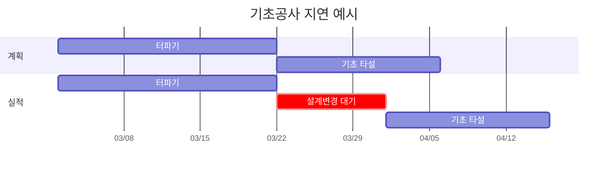
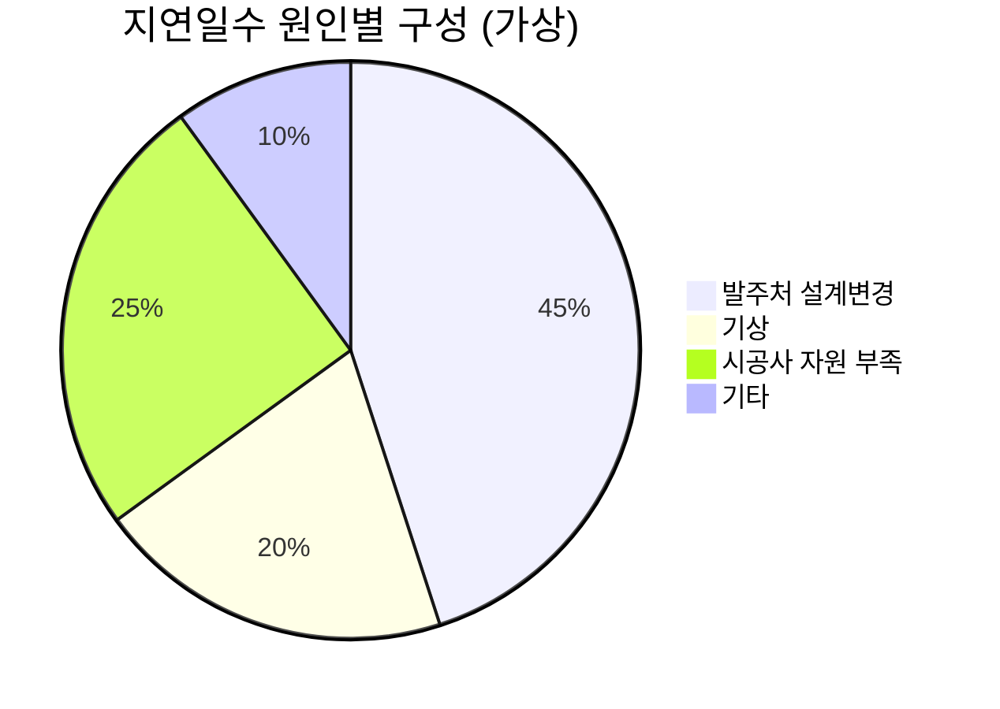
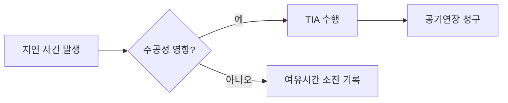

> [!info] 시험 발행 글
> 발행 흐름과 서식(표·차트·수식·강조 상자) 확인용 견본. 수치는 설명용 가상 예시.

## 요약
- 지연분석은 "누구 책임으로, 며칠 늦어졌는가"를 공정표로 증명하는 작업
- 방법은 크게 **계획 기준**과 **실적 기준**, **사전(전망)**과 **사후(회고)** 두 축으로 구분
- 어떤 방법을 쓸지는 계약 조건, 공정표 품질, 자료 보존 상태로 결정

## 1. 주요 방법 비교 (표)

| 방법 | 기준 공정표 | 시점 | 장점 | 한계 |
|---|---|---|---|---|
| As-Planned vs As-Built | 계획 + 실적 | 사후 | 단순, 직관적 | 원인별 책임 분리 어려움 |
| Impacted As-Planned | 계획 | 사후·전망 | 자료 적게 필요 | 실제 진행 무시 |
| Time Impact Analysis (TIA) | 갱신 공정표 | 전망 | 사건 발생 시점 반영 | 갱신 공정표 품질에 좌우 |
| Windows Analysis | 기간별 갱신본 | 사후 | 주공정 변화 추적 | 작업량 많음 |
| Collapsed As-Built | 실적 | 사후 | 실제 기록 기반 | 논리 재구성 필요 |

> [!tip] 실무 포인트
> 공정표 갱신본이 매월 보존되어 있다면 Windows Analysis가 가장 설득력 있음. 갱신본이 없으면 선택지가 급격히 줄어듦 — **갱신본 보관이 곧 클레임 대비.**

## 2. 지연 사건 예시 (간트 차트)

## 3. 지연 원인 구성 예시 (원형 차트)

## 4. 공정 흐름 (흐름도)

## 5. 수식

총여유(Total Float) 계산식:

$$TF = LF - EF = LS - ES$$

여유가 0인 작업이 모인 경로가 주공정(Critical Path).

## 6. 점검 목록

- [x] 기준 공정표 승인본 확보
- [x] 월별 갱신본 보관
- [ ] 지연 사건 기록부 정리
- [ ] 책임 구분(발주처·시공사·공동) 표 작성

## 참고
- SCL Delay and Disruption Protocol, 2nd Edition (2017)
- 본 사이트: [conpal.kr](https://conpal.kr)
